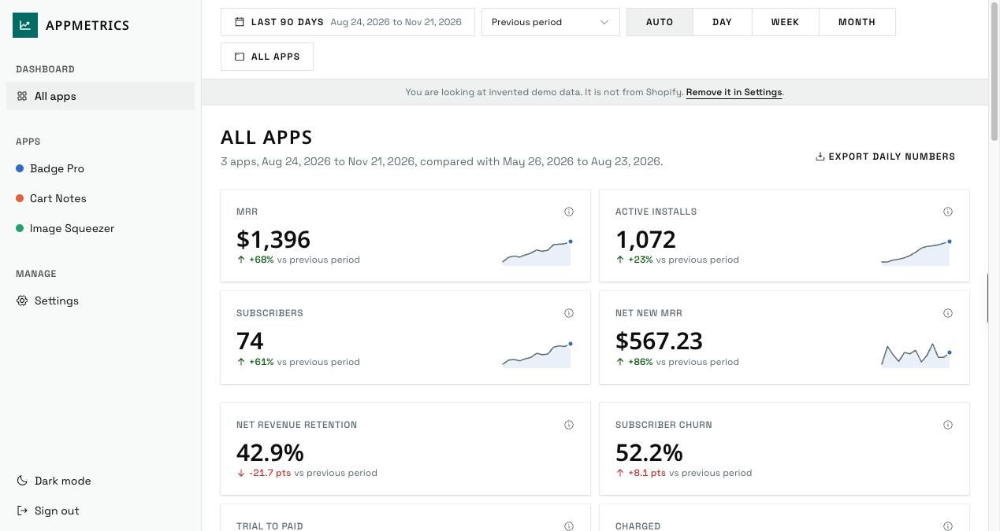
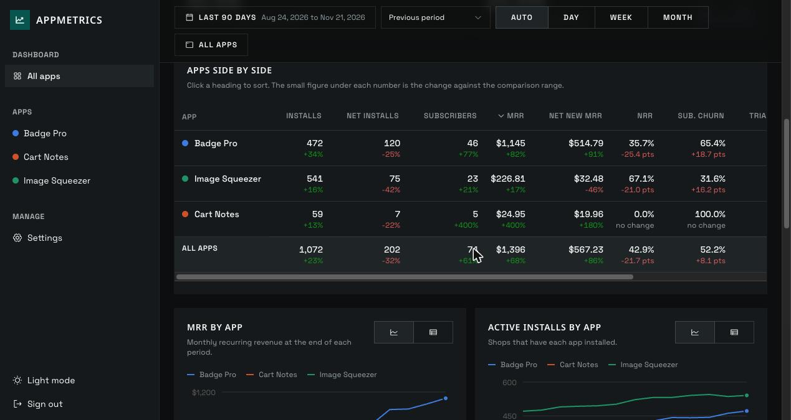
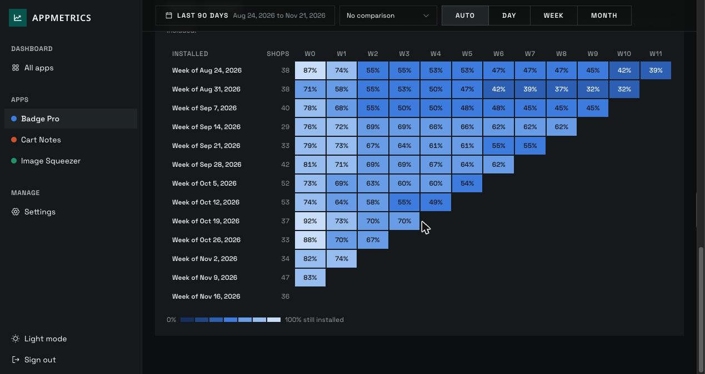

# AppMetrics

Installs, revenue and churn for your Shopify apps, in one dashboard you host yourself.

Shopify shows app developers an install count and a payout. It does not show MRR, churn, trial conversion, retention by cohort, or how your apps compare. AppMetrics reads the events Shopify's Partner API already reports about your apps, rebuilds the history from them, and shows the numbers a SaaS company would track.

It is built for one person: you. One login from an environment variable, one Docker Compose file, your own server.



## What you get

- **Every app side by side.** A table of all your apps against the metrics that matter, sortable, with the change since the last period under each number. Add more apps and they appear.
- **Any date range.** Presets for the usual spans, or pick any two days. Compare with the previous period or the same period last year. Group by day, week or month. The range lives in the URL, so a view can be bookmarked.
- **The numbers.** MRR, ARR, new, expansion, contraction and churned MRR, net and gross revenue retention, subscriber churn, ARPU, a lifetime value estimate, trial conversion, installs and uninstalls, uninstall reasons and what merchants wrote, how long installs last, cohort retention, plan mix, charges, fees and refunds. Every number has its definition one hover away, and [all of them are written down](docs/METRICS.md).
- **Per-app pages.** Overview, growth, revenue, retention, trials, churn, a searchable list of shops, and the raw event log.
- **CSV export** of the daily numbers, the shop list and the event log.

- **Light and dark.** Every chart has a table view.
- **Read-only.** It only ever sends read queries to Shopify.





## Status

Early. The reader was written against Shopify's published Partner API schema (version 2026-07) and is tested with responses of that shape. It has not yet been run against a live Partner organization, so expect to meet a surprise or two on the first real sync, and please open an issue when you do. The numbers shown are only as complete as the events the Partner API reports.

## Try it with demo data

You need Docker.

```bash
cp .env.example .env
# Put a long random value in POSTGRES_PASSWORD, SESSION_SECRET and ENCRYPTION_KEY, a password in
# DASHBOARD_PASSWORD, and set DEMO_MODE=true. docs/SELF_HOSTING.md shows how to generate them.

docker compose -f compose.yaml -f compose.local.yaml up -d --build
docker compose exec web node dist/cli.mjs seed-demo
```

Open http://localhost:3000 and sign in. The demo is three invented apps with a year of history. Remove it from Settings when you are done.

## Run it for real

[docs/SELF_HOSTING.md](docs/SELF_HOSTING.md) covers deploying with Docker Compose and on Coolify, creating the Partner API token, putting it behind HTTPS, updating and backing up.

## How it works

Three containers: `web` (the dashboard), `worker` (the only thing that talks to Shopify) and `db` (Postgres), plus a small `backup` container that dumps the database every 12 hours.

1. The worker reads new events from the Partner API on a schedule and stores each one once.
2. It rebuilds, from the events, one record per stay of a shop, per subscription period and per free trial, and sums them into a daily table.
3. The dashboard reads only that database. It never calls Shopify, so a slow or failing API cannot slow a page down.

More in [docs/ARCHITECTURE.md](docs/ARCHITECTURE.md).

## Configuration

Copy `.env.example` to `.env`. The ones you must set:

| Variable | What it is |
| --- | --- |
| `POSTGRES_PASSWORD` | Password for the bundled database. Use hex so it needs no escaping. |
| `DASHBOARD_USER` | The login name. Defaults to `admin`. |
| `DASHBOARD_PASSWORD_HASH` | A hash of your password, from `hash-password`. Preferred. |
| `DASHBOARD_PASSWORD` | Or the password itself, 12 characters or more. Set exactly one of the two. |
| `SESSION_SECRET` | Signs session tokens. 32 or more random characters. |
| `ENCRYPTION_KEY` | Encrypts stored Partner API tokens. 32 random bytes, base64. |

The app refuses to start, and says why, if any of these is missing or weak. The optional ones (sync interval, proxy settings, demo mode) are described in `.env.example`.

## Security

Short version: one login with a hashed password, throttled, over HTTPS; sessions stored as hashes and revocable; Partner API tokens encrypted at rest and never sent to a browser; a strict Content-Security-Policy; the database never published. The full model, and what it does not protect against, is in [SECURITY.md](SECURITY.md).

## Development

```bash
pnpm install
cp .env.example .env.local      # then fill it in; set DATABASE_URL to a Postgres you can reach
pnpm cli migrate
pnpm cli seed-demo
pnpm dev                        # http://localhost:3000
pnpm test                       # unit tests
```

See [CONTRIBUTING.md](CONTRIBUTING.md) for the integration tests and how the code is laid out.

## License

Copyright 2026 Md Shakhawat Hossen.

AppMetrics is open source under the [GNU Affero General Public License, version 3](LICENSE) only (`AGPL-3.0-only`). You can use it for any purpose, change it and share it. If you share it, or change it and let other people use your version over a network, you must offer them the complete source code of your version under the same license. It comes with no warranty.
